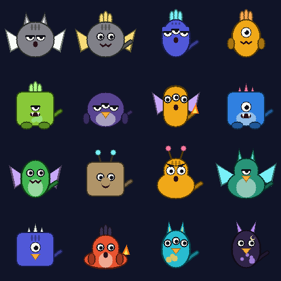

# BattleBuddies

An original pocket monster game for the ESP32-2432S028R "Cheap Yellow
Display" (2.8" 240x320 touch screen). Scan the radio signals around you to
discover a buddy, capture it with a timing mini-game, and build a collection.
Battles between two boards are coming in v0.2.



## How scanning works

The board has no barcode reader, so it listens instead. It scans for nearby
WiFi networks and Bluetooth devices, picks one (stronger, closer signals are
more likely), and grows a monster from that signal's hardware address.

- A WiFi router never changes its address, so **the same router always gives
  the same buddy**, on any board. Your kitchen, a friend's house and the
  library each have their own residents.
- Bluetooth gadgets often rotate their address, so they give wandering buddies.
- If no signals are around at all, you can still find a rare buddy "in the
  static".
- In the dark (the light sensor next to the screen), buddies show up in their
  **night form**: darker, faster and Shade-type.

Every buddy is built from a 32-bit seed: body shape, head, limbs, tail,
markings, eyes, mouth, colours, element, rarity, stats and name. Nothing is
stored as an image, and a future battle link only needs to send the seed and
the level.

Elements: Ember, Tide, Moss, Volt, Shade, Stone.
Rarity: Common, Uncommon, Rare, Legendary.

## Controls

- **WiFi scan** or **Bluetooth** runs the radar for that kind of signal.
  **Scan again** repeats the last kind.
- When the scan finishes, every signal it heard (up to the 16 strongest) shows
  up as a blip on the radar. Closer to the middle means a stronger signal, the
  colour is the element of the buddy living there, and a white ring means you
  already have it. Tap a blip to see the network or gadget name, then tap
  **Track it!** (or the same blip again) to meet that buddy. **Run** takes you
  back to the radar so you can pick another.
- **CAPTURE** starts the mini-game: tap when the red marker is in the green
  zone (gold centre = perfect). Rarer buddies have smaller zones and faster
  markers. You get three tries.
- Capturing a buddy you already own gives it XP instead, and it levels up.
- **Collection** shows your buddies, 9 per page. Tap one for its stats, or to
  release it.
- **Sound** toggles the speaker (saved). **?** opens a touch test.

## Building and flashing

You need [PlatformIO](https://platformio.org/) (VS Code extension or CLI).

```sh
pio run -e cyd -t upload      # build and flash over USB
pio device monitor            # serial log at 115200
```

Every push also builds on GitHub Actions; the `battlebuddies-firmware`
artifact holds a `firmware.bin`.

### If something looks off

These boards come in a few variants. Settings live in `platformio.ini` and
`src/config.h`:

- **Colours inverted:** uncomment `-DTFT_INVERSION_ON=1` in `platformio.ini`.
- **Blank or garbled screen:** try `-DILI9341_DRIVER=1` instead of
  `-DILI9341_2_DRIVER=1`.
- **Taps in the wrong place:** open the touch test (**?** on the title screen)
  and set `TOUCH_FLIP_X` / `TOUCH_FLIP_Y` or the `TOUCH_*_MIN/MAX` range in
  `src/config.h`.
- **Night forms never (or always) appear:** the serial log prints the light
  reading at boot; adjust `LIGHT_DARK_THRESHOLD`.
- **Too loud:** lower `SOUND_VOLUME`.

## Code map

| File | What it does |
| --- | --- |
| `src/monster.*` | Seed to monster: traits, colours, stats, names |
| `src/render.*` | Draws a monster from its traits at any size |
| `src/scanner.*` | WiFi + Bluetooth scan and signal pick |
| `src/storage.*` | Collection saved in flash (NVS) |
| `src/hw.*` | Touch, sound, RGB LED, light sensor |
| `src/main.cpp` | Screens and game flow |

## Roadmap

- **v0.1** scan, capture, collect (this)
- **v0.2** battles between two boards over ESP-NOW, type advantages
- later: trading, evolutions, an optional UART barcode module
