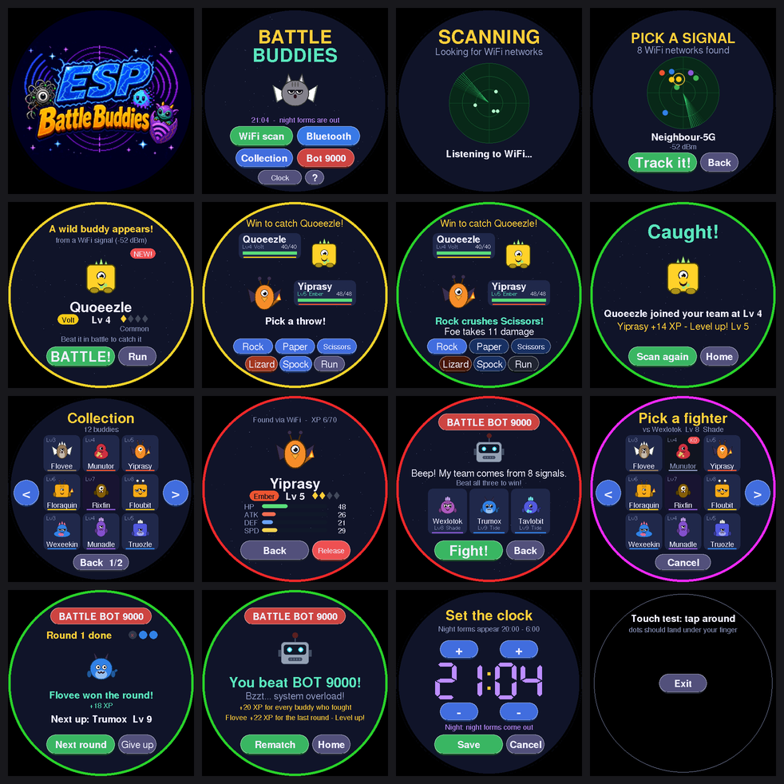

# BattleBuddies

An original pocket monster game for the ESP32-2432S028R "Cheap Yellow
Display" (2.8" 240x320 touch screen). Scan the radio signals around you to
discover a buddy, beat it in a Rock Paper Scissors Lizard Spock battle to
catch it, and build a collection. Then take your team up against Battle Bot
9000. The same battle is used everywhere; battles between two boards are next.


## How scanning works

The board has no barcode reader, so it listens instead. It scans for nearby
WiFi networks and Bluetooth devices, picks one (stronger, closer signals are
more likely), and grows a monster from that signal's hardware address.

- A WiFi router never changes its address, so **the same router always gives
  the same buddy**, on any board. Your kitchen, a friend's house and the
  library each have their own residents.
- Bluetooth gadgets often rotate their address, so they give wandering buddies.
- If no signals are around at all, you can still find a rare buddy "in the
  static".
- In the dark (the light sensor next to the screen), buddies show up in their
  **night form**: darker, faster and Shade-type.

Every buddy is built from a 32-bit seed: body shape, head, limbs, tail,
markings, eyes, mouth, colours, element, rarity, stats and name. Nothing is
stored as an image, and a future battle link only needs to send the seed and
the level.

Elements: Ember, Tide, Moss, Volt, Shade, Stone.
Rarity: Common, Uncommon, Rare, Legendary.

## Controls

- **WiFi scan** or **Bluetooth** runs the radar for that kind of signal.
  **Scan again** repeats the last kind.
- When the scan finishes, every signal it heard (up to the 16 strongest) shows
  up as a blip on the radar. Closer to the middle means a stronger signal, the
  colour is the element of the buddy living there, and a white ring means you
  already have it. Tap a blip to see the network or gadget name, then tap
  **Track it!** (or the same blip again) to meet that buddy. **Run** takes you
  back to the radar so you can pick another.
- **BATTLE!** on a wild buddy: pick one of your buddies to fight it. Win and
  the wild buddy joins your team (if you already have it, it gets XP instead),
  and your fighter earns XP too. Lose or **Run** and it gets away.
- Your very first buddy is free: with an empty collection the first wild buddy
  you meet offers to **Befriend** you, no battle needed.
- **Bot 9000** on the title screen: Battle Bot 9000 scans the WiFi and
  Bluetooth around him and builds a brand-new team of three from those
  signals, levelled near your best buddies. Each round you pick a fighter;
  a knocked-out buddy sits out the rest of the match. Beat all three to win
  (+20 XP bonus for everyone who fought); **Give up** ends the match.
- **Battles** (wild, Bot 9000, and later a friend's board) all work the same:
  every turn you both throw Rock, Paper, Scissors, Lizard or Spock (the usual
  rules: scissors cuts paper, Spock vaporizes rock...). The winner of the throw
  hits, harder with more ATK against less DEF. On a tie the faster buddy gets
  a small scrape in. Each element has a favoured throw worth +50% damage
  (highlighted in your buddy's colour): Stone Rock, Moss Paper, Volt Scissors,
  Ember Lizard, Shade Spock. Tide has none but always lands a half hit on
  ties. Winning a battle gives your fighter XP.
- **Collection** shows your buddies, 9 per page. Tap one for its stats, or to
  release it.
- **Sound** toggles the speaker (saved). **?** opens a touch test.

## Building and flashing

You need [PlatformIO](https://platformio.org/) (VS Code extension or CLI).

```sh
pio run -e cyd -t upload      # build and flash over USB
pio device monitor            # serial log at 115200
```

Every push also builds on GitHub Actions; the `battlebuddies-firmware`
artifact holds a `firmware.bin`.

### If something looks off

These boards come in a few variants. Settings live in `platformio.ini` and
`src/config.h`:

- **Colours inverted:** uncomment `-DTFT_INVERSION_ON=1` in `platformio.ini`.
- **Blank or garbled screen:** try `-DILI9341_DRIVER=1` instead of
  `-DILI9341_2_DRIVER=1`.
- **Taps in the wrong place:** open the touch test (**?** on the title screen)
  and set `TOUCH_FLIP_X` / `TOUCH_FLIP_Y` or the `TOUCH_*_MIN/MAX` range in
  `src/config.h`.
- **Night forms never (or always) appear:** the serial log prints the light
  reading at boot; adjust `LIGHT_DARK_THRESHOLD`.
- **Too loud:** lower `SOUND_VOLUME`.

## Round AMOLED version (Waveshare ESP32-S3 1.43")

The same game also runs on the Waveshare **ESP32-S3-Touch-AMOLED-1.43**
(466x466 round AMOLED, capacitive touch; the CNC metal case version is sold
as the "-1.43-B"). Same buddies, battles, Bot 9000 and save format; only the
screens are laid out for a circle.

```sh
pio run -e amoled143 -t upload
```

What's different on this board, and what stands in for it:

| CYD part | On the round board |
| --- | --- |
| Light sensor (night forms) | The on-board clock (PCF85063). Night forms appear from 20:00 to 06:00. Set the time with **Clock** on the title screen; until it's set there are no night forms. The clock keeps time while the board has power (or an RTC battery). |
| RGB LED | A glow ring round the edge of the screen in the same colours |
| Speaker | None on this board, so the game is silent |
| Resistive touch | Capacitive (FT3168); if taps land in the wrong place use the touch test (**?**) and the `TOUCH_*` flags in `src/round/board.h` |

The panel is driven over QSPI (SH8601 or CO5300, detected at start-up). The
game draws into a full-screen canvas in PSRAM and only the changed area is
sent to the panel each frame.

`tools/round_preview/make_previews.sh` builds the round screens on a PC and
renders every one to PNG, handy for checking layouts without flashing.



## Code map

| File | What it does |
| --- | --- |
| `src/monster.*` | Seed to monster: traits, colours, stats, names |
| `src/render.*` | Draws a monster from its traits at any size |
| `src/scanner.*` | WiFi + Bluetooth scan and signal pick |
| `src/storage.*` | Collection saved in flash (NVS) |
| `src/battle.*` | Battle rules (RPSLS throws, damage, AI), no hardware |
| `src/hw.*` | Touch, sound, RGB LED, light sensor |
| `src/main.cpp` | Screens and game flow |
| `src/round/` | Round AMOLED board: display driver, hardware layer, round screens |

## Roadmap

- **v0.1** scan, capture, collect
- **v0.2** battles: Rock Paper Scissors Lizard Spock against a computer
  buddy (done), then between two boards over ESP-NOW (the battle core is
  deterministic, so boards only need to swap seed, level and each throw)
- later: trading, evolutions, an optional UART barcode module
