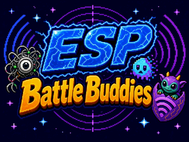

# BattleBuddies Player Guide

BattleBuddies is a pocket monster game that lives in the radio signals
around you. Every WiFi router and Bluetooth gadget has a buddy living in it.
Scan to find them, beat them in a battle to catch them, and build a team
strong enough to take on Battle Bot 9000 and your friends.



## Contents

1. [Controls at a glance](#01-controls-at-a-glance)
2. [Getting started](#02-getting-started)
3. [The title screen](#03-the-title-screen)
4. [Scanning and the radar](#04-scanning-and-the-radar)
5. [Meeting a wild buddy](#05-meeting-a-wild-buddy)
6. [Battles](#06-battles)
7. [Elements and favourite throws](#07-elements-and-favourite-throws)
8. [Levels, XP and stats](#08-levels-xp-and-stats)
9. [Your collection](#09-your-collection)
10. [Battle Bot 9000](#10-battle-bot-9000)
11. [Friend battles](#11-friend-battles)
12. [Night forms](#12-night-forms)
13. [Sound, lights and the touch test](#13-sound-lights-and-the-touch-test)
14. [Tips](#14-tips)
15. [Flashing the Cheap Yellow Display (CYD)](#15-flashing-the-cheap-yellow-display-cyd)
16. [Troubleshooting](#16-troubleshooting)

---

## 01 Controls at a glance

Everything is done by tapping the screen.

- **Tap a button** to press it. Each press gives a short click.
- **Tap a blip** on the radar to select that signal. **Tap it again** to track it.
- **Tap a buddy** in your collection to see its stats.
- **Tap Release twice** to let a buddy go. The first tap asks *Sure?*.
- **Tap the boot logo** to skip it.

Everything saves automatically and survives power-off: your buddies, their
levels and XP, and the sound setting.

## 02 Getting started

1. **Power on.** The BattleBuddies logo shows for a couple of seconds while
   the radio wakes up. Tap to skip it.
2. **Scan.** On the title screen tap **WiFi scan** (or **Bluetooth**).
3. **Pick a signal.** When the radar stops, tap a blip, then **Track it!**.
4. **Befriend your first buddy.** With an empty collection the first buddy
   you meet joins you for free. Tap **Befriend**.
5. **Catch more.** From now on, wild buddies have to be beaten in a battle
   before they join you. Tap **BATTLE!** and pick a fighter.

## 03 The title screen

| Button | What it does |
| --- | --- |
| **WiFi scan** | Scans nearby WiFi networks and opens the radar. |
| **Bluetooth** | Scans nearby Bluetooth gadgets and opens the radar. |
| **Collection** | Shows your buddies (see [09](#09-your-collection)). |
| **Bot 9000** | Starts a match against Battle Bot 9000 (see [10](#10-battle-bot-9000)). |
| **Friend** | Battles another board nearby (see [11](#11-friend-battles)). |
| **Sound: on / off** | Turns the speaker on or off. The setting is saved. |
| **?** | Opens the touch test (see [13](#13-sound-lights-and-the-touch-test)). |

**Bot 9000** and **Friend** need at least one buddy. With an empty collection
the button just says *No buddy*.

## 04 Scanning and the radar

The board has no camera or barcode reader, so it listens instead. Each
signal's hardware address is turned into a buddy: its shape, colours,
element, rarity, stats and name.

- **The same router always gives the same buddy**, on any board. Your
  kitchen, a friend's house and the library each have their own residents.
- **Bluetooth gadgets** (phones, watches, earbuds) often change their address,
  so they give wandering buddies that may not come back.
- **Nothing on the air?** If the scan hears nothing at all, you go straight
  to a buddy found *out of the static*.

The radar sweeps for a few seconds, then every signal it heard (up to the 16
strongest) appears as a blip on the **Pick a signal** screen.

| On the radar | Means |
| --- | --- |
| **Closer to the middle** | Stronger signal, so the source is nearby. |
| **Blip colour** | The element of the buddy living there. |
| **White ring** | You already have that buddy. |
| **Pulsing gold ring** | The blip you selected. |

Tap a blip to see the network or gadget name and its signal strength, then
tap **Track it!** (or the same blip again) to meet that buddy. **Back**
returns to the title screen. Each signal always sits at the same spot on the
radar, so you learn your neighbourhood.

## 05 Meeting a wild buddy

The encounter screen shows the buddy, where it came from, its name,
element, level and rarity (one to four gems). A red **NEW!** tag means you
don't have it yet.

- **BATTLE!** Pick one of your buddies and fight. Win and the wild buddy
  joins your team.
- **Befriend** appears instead of BATTLE! only for your very first buddy.
- **Run** goes back to the radar so you can pick another signal (or to the
  title screen, for a buddy found in the static).

After a wild battle the result screen shows one of these:

| Result | What happened |
| --- | --- |
| **New friend!** | Your first buddy joined you. |
| **Caught!** | You won and the buddy joined your team. |
| **Power up!** | You won, but you already had it, so your copy gets XP instead. |
| **Team full!** | You won, but the collection holds 96 buddies. Release one to make room. |
| **It got away** | You lost, or you ran from the battle. |

Your fighter's XP (and any level up) is shown underneath. **Scan again**
repeats the same kind of scan, **Home** goes back to the title.

Rarity is set by the signal: about 59% Common, 27% Uncommon, 12% Rare and
2% Legendary. Rarer buddies start at higher levels and have better stats.

## 06 Battles

Wild battles, Battle Bot 9000 and friend battles all use the same rules.
Your buddy is at the bottom left, the opponent at the top right.

1. **Pick a throw.** Each turn both sides throw Rock, Paper, Scissors,
   Lizard or Spock at the same time.
2. **The winner hits.** Whoever wins the throw deals damage. More ATK
   against less DEF means a harder hit.
3. **Keep going.** First buddy to 0 HP loses. **Run** ends the battle at
   any time, and counts as a loss.

Who beats who:

| Throw | Beats |
| --- | --- |
| **Rock** | crushes Scissors, crushes Lizard |
| **Paper** | covers Rock, disproves Spock |
| **Scissors** | cuts Paper, decapitates Lizard |
| **Lizard** | poisons Spock, eats Paper |
| **Spock** | smashes Scissors, vaporizes Rock |

**Ties.** Nobody wins the throw, but the faster buddy (higher SPD) gets a
small scrape in. If both are equally fast, both get scraped. A tie can never
knock anyone out, so every battle ends on a real win.

The HP bar turns gold below half and red below a fifth. A buddy with equal
stats to its foe needs about 3 to 5 winning throws to finish it.

## 07 Elements and favourite throws

Every buddy has one of six elements. Five of them have a **favourite
throw** that hits 50% harder when it wins. Your favourite throw is
highlighted in your buddy's colour on the battle buttons.

| Element | Favourite throw | Notes |
| --- | --- | --- |
| **Ember** | Lizard | Always has a flame tail. |
| **Tide** | none | **Tide flows:** on every tie it lands a half hit, whatever its speed. |
| **Moss** | Paper | |
| **Volt** | Scissors | |
| **Shade** | Spock | Every night form is Shade (see [12](#12-night-forms)). |
| **Stone** | Rock | |

**Good to know.** Opponents know their favourite throw too. The computer
throws it about a third of the time, and sometimes tries to beat whatever
you threw last turn.

## 08 Levels, XP and stats

Each buddy has four stats, shown as bars on its detail screen:

- **HP**: how much damage it can take.
- **ATK**: how hard it hits.
- **DEF**: how well it shrugs off hits.
- **SPD**: who wins the scrape on a tie.

Stats grow by 8% for every level. Buddies earn XP by winning battles. Beating
a higher level or rarer foe gives more XP. Going from level *L* to the next
needs 20 + 10 × *L* XP, up to level 99.

| Way to earn XP | XP |
| --- | --- |
| Win any battle | 12 + 6 × foe's level + 5 × foe's rarity (0 to 3) |
| Beat a wild buddy you already have | your copy also gets 10 + 5 × its level |
| Beat all of Battle Bot 9000's team | +20 bonus for every buddy that fought |

## 09 Your collection

**Collection** shows your buddies, 9 per page, with their name and level.
A darker tile is a night form, and the coloured strip is its element. Use
**<** and **>** to turn pages (they wrap around), and **Back** to go home.

Tap a buddy for its detail screen: name, element, level, rarity, the four
stats, where it was found (WiFi, Bluetooth or the static) and XP towards the
next level.

- **Release** lets the buddy go. Tap it, then tap **Sure?** to confirm. This
  can't be undone, but you can always catch it again at the same signal.

The collection holds up to 96 buddies. A night form and the day form of the
same signal count as two different buddies.

## 10 Battle Bot 9000

Battle Bot 9000 is the computer opponent. Every match he runs a fresh WiFi
and Bluetooth scan and builds a brand-new team of three from the signals
around him, levelled close to the average of your three best buddies.

1. **Tap Bot 9000** on the title screen. He scans and shows his team.
2. **Tap Fight!** and pick a fighter for round one.
3. **Win the round** and his next buddy comes out. **Lose** and your
   fighter is knocked out (marked **KO**) and sits out the rest of the
   match.
4. **Beat all three** to win the match. Every buddy that fought gets a +20
   XP bonus.

The dots at the top right show his team: coloured means still standing.
Between rounds, **Next round** continues and **Give up** ends the match.
If all your buddies are knocked out, Bot wins. After a match, **Rematch**
starts over with a fresh scan, so a different place gives a different team.

## 11 Friend battles

Two boards can battle each other directly, with no router or internet
needed.

1. **Both players tap Friend** on the title screen, with the boards close
   together.
2. **Wait for "Found a friend!"** The boards find each other in a few
   seconds.
3. **Each player picks a buddy.** Neither sees the other's pick until both
   are in.
4. **Battle.** Each turn your throw is locked in secretly. Once both throws
   are locked, they are revealed together.

**Can my friend peek at my throw?** No. Each board sends a sealed lock of
its throw first and only reveals the throw once the other lock has arrived.
If a revealed throw doesn't match its lock, the battle stops with *Battle
stopped*.

How a friend battle can end:

| Screen | Means |
| --- | --- |
| **Victory!** | You won. Your buddy gets XP. |
| **Defeated** | Your friend won. |
| **You ran** | You tapped Run, so your friend wins. |
| **Friend left** | Your friend ran or cancelled. If it was mid-battle, you win and get XP. |
| **Connection lost** | The other board was silent for 12 seconds. Move closer and try again. |

**Battle again** looks for your friend again, **Home** goes back to the
title. **Cancel** while searching or waiting leaves the match.

## 12 Night forms

The light sensor next to the screen tells the board when it's dark. Scan in
the dark and the buddies you find are **night forms**: the same creature,
but darker, a little faster (+4 SPD) and always **Shade**, which favours
Spock.

Night forms count as their own buddies in your collection, so every signal
can give you two: one by day and one by night. The encounter screen says
*A night form appears!* when you meet one.

## 13 Sound, lights and the touch test

- **Sound** on the title screen turns the speaker on or off. The board
  remembers your choice.
- **The RGB LED** on the back follows the action: it glows the element's
  colour when a buddy appears (Ember red, Tide blue, Moss green, Volt
  yellow, Shade purple, Stone cyan), green when you win a throw or a
  battle, red when you lose one, and yellow on a tie.
- **?** opens the touch test. Tap around the screen. A gold dot should land
  right under your finger, and the x/y position shows at the bottom. Tap
  **Exit** to go back. If the dots land in the wrong place, see
  [Troubleshooting](#16-troubleshooting).

## 14 Tips

- **Explore.** Every place has different buddies. Scan at school, a café or
  a friend's house to find new ones.
- **Go close.** Strong signals sit near the middle of the radar. Walk up to
  a router to make its blip easier to pick out.
- **Use your favourite throw**, but not every turn. The computer watches
  what you threw last.
- **Level a few buddies.** Bot 9000 matches your three best, so a strong
  core team makes his matches fair but tough.
- **Bring a spare.** Against Bot 9000, a knocked out buddy can't come back
  in the same match, so build a team of at least three.
- **Turn off the lights** to hunt for Shade night forms.

## 15 Flashing the Cheap Yellow Display (CYD)

This section is for the ESP32-2432S028R "Cheap Yellow Display" board. You
need [PlatformIO](https://platformio.org/) (the VS Code extension or the
command line).

1. **Plug the board in** over USB and note its COM port (Windows) or
   `/dev/ttyUSB*` port (Linux/macOS).
2. **Start the upload** from the repository folder:

   ```sh
   pio run -e cyd -t upload
   ```

3. **Put the board in download mode** when the upload starts trying to
   connect (`Connecting...`). Many CYD boards don't switch on their own:
   - hold **BOOT**,
   - tap **RST** once while still holding BOOT,
   - keep holding **BOOT** for about 3 seconds, then let go.

   If the upload gives up, run the command again and repeat the button
   routine.
4. **Start the game.** If the screen stays dark after `Hard resetting...`,
   tap **RST** once.

To watch the serial log (it prints the light reading at boot):

```sh
pio device monitor
```

**Good to know.** Flashing a new version keeps your collection. It is only
wiped if you erase the whole flash (for example `pio run -t erase`).

Every push to the repository also builds on GitHub Actions. The
`battlebuddies-firmware` artifact holds a ready-made `firmware.bin`.

## 16 Troubleshooting

CYD boards come in a few variants. The settings live in `platformio.ini` and
`src/config.h`.

| Problem | Fix |
| --- | --- |
| **Colours look inverted** | Uncomment `-DTFT_INVERSION_ON=1` in `platformio.ini`. |
| **Blank or garbled screen** | Try `-DILI9341_DRIVER=1` instead of `-DILI9341_2_DRIVER=1`. |
| **Taps land in the wrong place** | Open the touch test (**?**) and set `TOUCH_FLIP_X` / `TOUCH_FLIP_Y` or the `TOUCH_*_MIN/MAX` range in `src/config.h`. |
| **Night forms never (or always) appear** | Check the light reading in the serial log and adjust `LIGHT_DARK_THRESHOLD`. Higher readings mean darker. |
| **Too loud** | Lower `SOUND_VOLUME` (0 to 511), or turn Sound off. |
| **Friend can't be found** | Both boards must run the same version and tap Friend. Keep them within a few metres. |
| **Upload never connects** | Repeat the BOOT + RST routine in [15](#15-flashing-the-cheap-yellow-display-cyd), and try another USB cable. |
